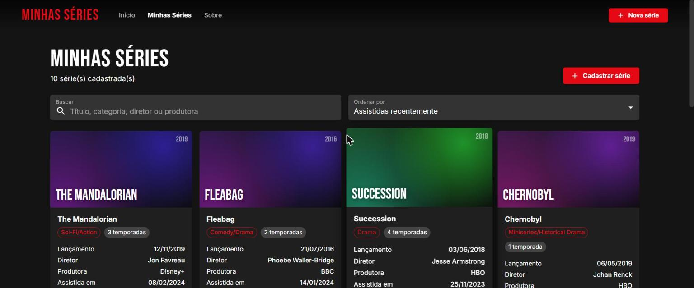
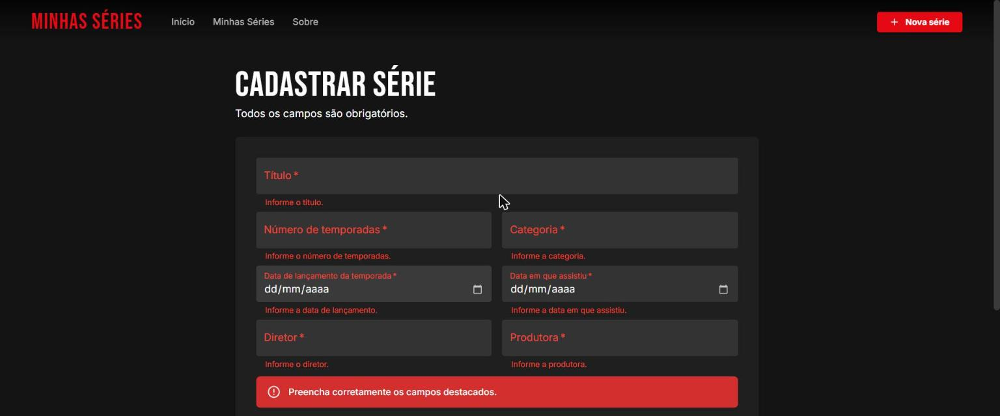
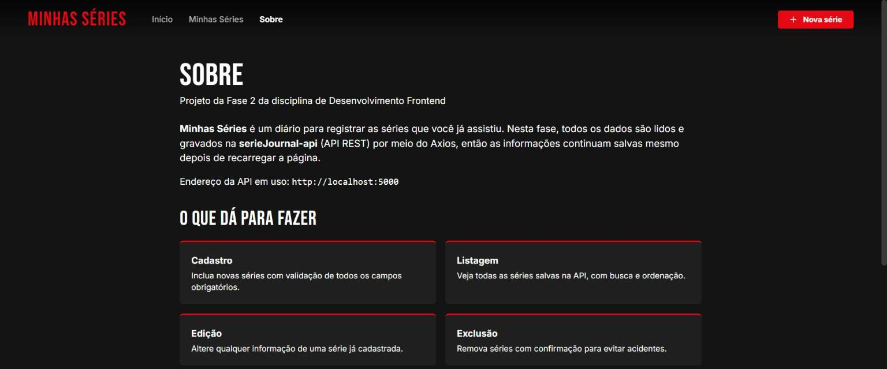

# Minhas Séries — Projeto Fase 2

Aplicação React para registrar as séries que você assistiu, com visual escuro inspirado em plataformas de streaming. Nesta fase, todos os dados vêm da **serieJournal-api** (API REST) e são consumidos com **Axios**: listagem, busca, cadastro, edição e exclusão são dinâmicos e ficam salvos mesmo depois de recarregar a página.

**Tecnologias:** React 19 + Vite · React Router · Material UI (MUI) · Axios · Vitest + Testing Library

## Como executar o projeto

Pré-requisito: [Node.js](https://nodejs.org/) 20 ou superior.

### 1. Subir a API (serieJournal-api)

A API não faz parte deste .zip. Em um terminal:

```bash
git clone https://github.com/adsPucrsOnline/DesenvolvimentoFrontend.git
cd ./DesenvolvimentoFrontend/serieJournal-api/
npm install
npm start
```

A API fica disponível em http://localhost:5000/series.

### 2. Rodar o frontend

Em **outro** terminal, na pasta deste projeto:

```bash
npm install
npm run dev
```

Depois, abra no navegador o endereço exibido no terminal (normalmente http://localhost:5173).

> O frontend usa `http://localhost:5000` por padrão. Se a API estiver em outro endereço, copie `.env.example` para `.env` e altere `VITE_API_URL`.

Outros comandos:

```bash
npm run build    # gera a versão de produção na pasta dist
npm run preview  # serve a versão gerada pelo build
npm run lint     # verifica o código com o ESLint
```

## Testes

Os testes usam **Vitest** + **React Testing Library** (ambiente jsdom). A API é simulada com `vi.mock`, então **não é preciso** que ela esteja rodando.

```bash
npm test             # executa todos os testes uma vez
npm run test:watch   # modo observação
```

São 21 testes em 4 arquivos:

| Arquivo | O que testa |
| --- | --- |
| `src/Components/SerieForm/SerieForm.test.jsx` | Regras de validação (campos obrigatórios, temporadas inteiras ≥ 1, data assistida não anterior ao lançamento nem futura), envio no formato da API, limpeza após cadastro, formulário preenchido na edição e exibição de erro da API |
| `src/Components/SerieList/SerieList.test.jsx` | Exibição de todas as informações, ordenação padrão, busca por título/categoria/produtora, callbacks de editar/excluir e lista vazia |
| `src/pages/Lista.test.jsx` | Carregamento via `GET /series`, erro de conexão com "Tentar novamente", exclusão com confirmação (`DELETE`), cancelamento e navegação para a edição |
| `src/pages/Editar.test.jsx` | Carregamento via `GET /series/:id`, salvamento via `PUT`, série inexistente (404) e erro de conexão no cadastro (`POST`) |

## Imagens do projeto

**Início**


**Minhas Séries (listagem com busca, edição e exclusão)**


**Cadastro (com validação)**


**Sobre**


## Páginas (rotas)

| Rota | Página | Descrição | API |
| --- | --- | --- | --- |
| `/` | Home | Recepciona o usuário com um banner e mostra a última série assistida e fileiras de séries | `GET /series` |
| `/sobre` | Sobre | Página informativa sobre o projeto e as tecnologias | — |
| `/cadastro` | Cadastro | Formulário para incluir uma nova série | `POST /series` |
| `/series` | Lista | Todas as séries com busca, ordenação e botões de editar/excluir em cada item | `GET /series`, `DELETE /series/:id` |
| `/editar/:id` | Editar | Formulário preenchido com os dados da série para alteração | `GET /series/:id`, `PUT /series` |
| `*` | NaoEncontrada | Página exibida para endereços inexistentes | — |

## Componentes

- **NavBar** (`src/Components/NavBar`): barra superior fixa — transparente no topo e escura ao rolar a página. Tem o logo, os links (`NavLink` destaca a página atual), o botão "Nova série" e um menu lateral (Drawer) em telas pequenas.
- **Footer** (`src/Components/Footer`): rodapé exibido em todas as páginas.
- **Pagina** (`src/Components/Pagina`): estrutura padrão das páginas internas (título, subtítulo, ações e conteúdo), com espaço para a barra fixa.
- **SerieForm** (`src/Components/SerieForm`): formulário com Título, Número de Temporadas, Data de Lançamento da Temporada, Diretor, Produtora, Categoria (lista de sugestões ou texto livre) e Data em que assistiu. Valida os campos, destaca os erros, mostra o botão em estado de carregamento durante a requisição e exibe mensagens de sucesso/erro. É reutilizado no cadastro e na edição.
- **SerieList** (`src/Components/SerieList`): recebe as séries **via props** e as exibe em grade, com campo de busca (título, categoria, diretor ou produtora) e seleção de ordenação.
- **SerieCard** (`src/Components/SerieCard`): cartão de uma série com todas as informações e os botões **Editar** e **Excluir**.
- **SeriePoster** (`src/Components/SeriePoster`): "pôster" gerado com degradês a partir do título (a API não fornece imagens); o mesmo título sempre gera as mesmas cores.
- **SerieRow** (`src/Components/SerieRow`): fileira horizontal de pôsteres usada na página inicial; clicar em um pôster abre a edição.
- **ConfirmDialog** (`src/Components/ConfirmDialog`): caixa de diálogo de confirmação usada antes de excluir.
- **EstadoApi** (`src/Components/EstadoApi`): `Carregando` (indicador durante as requisições) e `ErroApi` (mensagem de erro com botão "Tentar novamente").

Outros arquivos:

- **`src/services/api.js`**: instância do Axios e as funções `listarSeries`, `buscarSerie`, `criarSerie`, `atualizarSerie` e `excluirSerie`, além de `mensagemDeErro`, que traduz falhas em mensagens amigáveis.
- **`src/utils/validacao.js`**: regras de validação e valores iniciais do formulário.
- **`src/utils/formatadores.js`**: formatação de datas, cores dos pôsteres e ordenação por data assistida.
- **`src/theme.js`**: tema do MUI (modo escuro, vermelho `#E50914`, fontes Bebas Neue e Inter).

## Decisões de desenvolvimento

- **A API é a fonte dos dados**: cada página busca o que precisa direto da API, em vez de manter uma cópia global no `App`. Assim a lista sempre reflete o que está salvo no servidor.
- **Campos com os nomes da API** (`title`, `seasons`, `releaseDate`, `director`, `production`, `category`, `watchedAt`): evita conversões e mantém compatibilidade com as séries que já vêm na API.
- **Nova tentativa automática**: a serieJournal-api roda com `nodemon`, que reinicia o servidor toda vez que o arquivo `series.json` é gravado. Por isso, logo depois de cadastrar, editar ou excluir, a próxima requisição pode falhar por um instante. Um interceptor do Axios tenta de novo (até 3 vezes) quando não há resposta do servidor.
- **Feedback em todas as ações**: indicador de carregamento, mensagens de erro com "Tentar novamente", confirmação antes de excluir e avisos (Snackbar) de sucesso.
- **Categoria livre**: a API traz categorias como "Drama/Crime", então o campo sugere uma lista mas aceita qualquer texto.

## Estrutura de pastas

```
src/
├── App.jsx                  # rotas da aplicação
├── main.jsx                 # ponto de entrada (ThemeProvider + BrowserRouter)
├── theme.js                 # tema do Material UI
├── index.css                # estilos globais
├── services/api.js          # comunicação com a API (Axios)
├── utils/                   # validação e formatadores
├── test/                    # configuração e dados dos testes
├── Components/
│   ├── NavBar/  Footer/  Pagina/
│   ├── SerieForm/  SerieList/  SerieCard/
│   ├── SeriePoster/  SerieRow/
│   └── ConfirmDialog/  EstadoApi/
└── pages/
    ├── Home.jsx  Sobre.jsx  Cadastro.jsx
    ├── Lista.jsx  Editar.jsx  NaoEncontrada.jsx
    └── *.test.jsx
```
