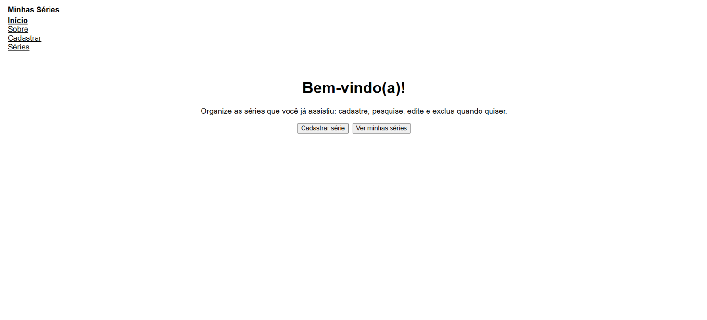
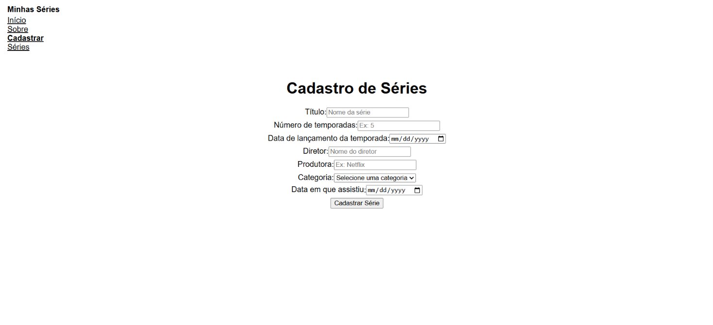
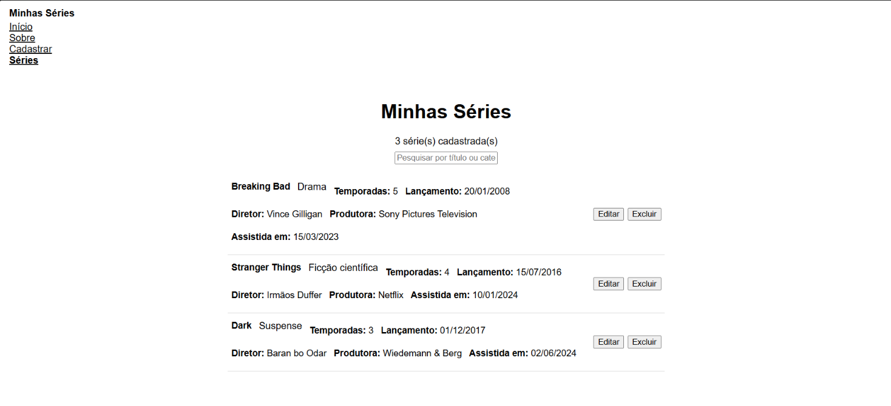

# Minhas Séries — Projeto Fase 1

Aplicação React para cadastrar e gerenciar as séries que você assistiu. Permite cadastrar, listar, pesquisar, editar e excluir séries, com validação do formulário e feedback visual para o usuário.

Projeto criado com [Vite](https://vite.dev/) + React, usando [React Router](https://reactrouter.com/) para a navegação entre telas.

## Sobre esta fase

Este repositório contém a **Fase 1** do projeto. Nesta etapa, o foco é o front-end: estrutura de páginas e rotas, componentes reutilizáveis, formulário com validação e o CRUD de séries (cadastrar, listar, pesquisar, editar e excluir) com dados mantidos apenas em memória, sem back-end nem persistência.

## Como executar o projeto

Pré-requisito: [Node.js](https://nodejs.org/) instalado (versão 20 ou superior).

```bash
# 1. Instalar as dependências (cria a pasta node_modules)
npm install

# 2. Rodar em modo de desenvolvimento
npm run dev
```

Depois, abra no navegador o endereço exibido no terminal (normalmente http://localhost:5173).

Outros comandos:

```bash
npm run build    # gera a versão de produção na pasta dist
npm run preview  # serve a versão gerada pelo build
npm run lint     # verifica o código com o ESLint
```

## Testes

O projeto não possui testes automatizados nesta fase.

## Imagens do projeto

<!-- Coloque os prints/GIF na pasta docs/ e ajuste os nomes abaixo -->





## Páginas (rotas)

| Rota          | Página     | Descrição                                                        |
| ------------- | ---------- | ---------------------------------------------------------------- |
| `/`           | Home       | Página inicial que recepciona o usuário                          |
| `/sobre`      | Sobre      | Página informativa sobre a aplicação                             |
| `/cadastro`   | Cadastro   | Formulário para incluir uma nova série                           |
| `/series`     | Lista      | Lista de séries cadastradas, com busca, edição e exclusão        |
| `/editar/:id` | Editar     | Formulário preenchido com os dados da série para alteração       |

## Componentes

- **NavBar** (`src/Components/NavBar`): barra de navegação com os links para Início, Sobre, Cadastrar e Séries. Usa `NavLink`, que destaca o link da página atual.
- **SerieForm** (`src/Components/SerieForm`): formulário com os campos Título, Número de Temporadas, Data de Lançamento da Temporada, Diretor, Produtora, Categoria e Data em que assistiu. Faz a validação dos campos (obrigatórios, mínimo de 1 temporada e data assistida não anterior ao lançamento), destaca em vermelho os campos com erro e mostra mensagens de sucesso/erro. É reutilizado no cadastro e na edição.
- **SerieList** (`src/Components/SerieList`): recebe a lista de séries **via props** e exibe todas as informações de cada uma, com campo de busca (por título ou categoria) e botões de **Editar** e **Excluir** ao lado de cada item.

Páginas (`src/pages`): `Home`, `Sobre`, `Cadastro`, `Lista` e `Editar` — montam os componentes acima em cada rota.

## Decisões de desenvolvimento

- **Estado centralizado no `App.jsx`**: a lista de séries fica em um `useState` no `App` e é passada por props para as páginas. As funções de adicionar, atualizar e excluir também ficam no `App`, assim todas as telas enxergam os mesmos dados.
- **Dados estáticos**: não há back-end. A lista começa com séries de exemplo (`src/data/seriesIniciais.js`) e as alterações ficam apenas em memória — ao recarregar a página, os dados voltam ao estado inicial.
- **Um formulário para cadastro e edição**: o `SerieForm` recebe `serieInicial` (opcional) e `onSalvar`, evitando duplicar código.
- **Confirmação ao excluir**: antes de remover uma série é exibida uma confirmação para evitar exclusões acidentais.
- **React Router** em vez de `window.location.href`: a navegação acontece sem recarregar a página, o que preserva o estado da aplicação.

## Estrutura de pastas

```
src/
├── App.jsx / App.css        # rotas e estado da aplicação
├── main.jsx                 # ponto de entrada (BrowserRouter)
├── index.css                # estilos globais
├── data/seriesIniciais.js   # séries de exemplo
├── Components/
│   ├── NavBar/
│   ├── SerieForm/
│   └── SerieList/
└── pages/
    ├── Home.jsx
    ├── Sobre.jsx
    ├── Cadastro.jsx
    ├── Lista.jsx
    └── Editar.jsx
```
